# ours — que un modelo de IA decida como decide tu equipo

## TL;DR

- **Qué es:** una capa que se monta encima de un modelo de IA pequeño y abierto (JevK5, 4 000 millones de parámetros) para que tome
  decisiones de opción cerrada —"¿es urgente?", "¿a qué equipo va?", "¿se aprueba el reembolso?"— **aprendiendo de las decisiones que
  tu equipo ya tomó**, sin reentrenar el modelo.
- **Qué gana:** en nuestras pruebas, con 1000 decisiones pasadas, acierta **hasta 11 puntos más** que el modelo solo (moderación: 80 % → 91 %;
  intenciones de usuario: 70 % → 75 %), está **mejor calibrado** (cuando dice "90 % seguro", acierta más cerca del 90 %), mantiene
  **coherentes** las respuestas que dependen entre sí, y puede decirte **qué casos es seguro automatizar** y cuáles mandar a una persona.
- **Cuánto cuesta:** lo mismo que el modelo solo. No escribe texto ni alarga el prompt: lee la respuesta en una sola pasada y agrega
  unos 2 ms. Corre en tu máquina (GPU o CPU) y tus datos no salen de ella.
- **Cómo se usa:** `dec-pool build` con tu historial de decisiones → `dec-serve --pool-dir` → le mandás casos por HTTP y te devuelve la
  decisión con su probabilidad, los precedentes en los que se apoyó y si conviene escalarla. Ver [Puesta en producción](#5-puesta-en-producción-en-tu-máquina).
- **Licencia:** uso libre para investigación, estudio y uso personal o sin fines de lucro; **no se permite uso comercial** ([PolyForm Noncommercial 1.0.0](LICENSE)).

## Qué hace, en criollo

Los *decision models* (Jev, Microsoft Decision‑1, JevK5…) son modelos de lenguaje entrenados para elegir entre opciones y dar una
probabilidad por cada una. Son buenos, pero deciden "en general": no saben cómo decide **tu** organización. Para ellos, un ticket
"no puedo entrar a mi cuenta" es igual de urgente en cualquier empresa.

`ours` les agrega cuatro cosas:

1. **Memoria de precedentes.** Guarda tus decisiones pasadas. Ante un caso nuevo busca los más parecidos y mezcla "lo que diría el
   modelo" con "lo que hizo tu equipo en casos así", según cuánta evidencia haya. Si no hay precedentes parecidos, confía en el modelo.
2. **Coherencia entre preguntas.** Si le preguntás la intención ("reservar vuelo") y el tema ("viajes") de un mismo pedido, no deja que
   las respuestas se contradigan. Solo esto subió la precisión de 70 % a 78 % en uno de los conjuntos, sin ningún dato extra.
3. **Riesgo y costo.** Con tus decisiones pasadas calcula un umbral para automatizar solo lo que tiene un error acotado con garantía
   estadística (en un conjunto: 20 % de los casos automatizados con 0.4 % de error). Si le decís que perder una amenaza cuesta 10
   veces más que una falsa alarma, decide en consecuencia, y puede responder **"escalar"** en vez de adivinar.
4. **Traza.** Cada decisión viene con su razón: qué dijo el modelo, qué precedentes usó, cuánta evidencia había y por qué escaló o no.

**Ejemplo.** Un equipo de soporte tiene 2000 tickets ya clasificados por prioridad. Arma la memoria con ellos, levanta el servidor y le
manda cada ticket nuevo. Recibe "prioridad alta, 87 %, basado en estos 5 tickets parecidos". Los casos con confianza suficiente se
asignan solos; el resto va a una persona, que ahora tiene menos tickets que mirar.

**Qué no hace.** No mejora al modelo en benchmarks públicos sin datos tuyos (ahí empata con JevK5). No aprende bien clases muy raras con
pocos ejemplos: si tenés 50 amenazas entre 3000 comentarios, la memoria tiende a "no ver" amenazas; para eso conviene decidir por costo
(ver [resultados](#la-precisión-engaña-en-clases-raras)). Necesita **al menos ~200 decisiones pasadas por pregunta** para ayudar; con menos
puede empeorar.

## Detalle técnico

El paquete Python se llama `dec` (comandos `dec-pool`, `dec-serve`, `dec-eval`). Backbone por defecto: **JevK5** (Qwen3.5‑4B afinado para
decisiones, Apache‑2.0). Configuración recomendada: **Ours‑3‑cal** (memoria sobre embeddings MiniLM + métrica aprendida + recalibración).

| Eje | Qué hace | Qué necesita de tu lado |
|---|---|---|
| **Precedente** | memoria de decisiones pasadas (vecinos más cercanos sobre MiniLM o sobre el estado oculto del modelo) fusionada con la probabilidad del modelo | decisiones pasadas con su resultado |
| **Coherencia** | decodificación conjunta de varias preguntas sobre el mismo caso bajo restricciones declaradas (jerarquías, implicaciones) | la relación entre preguntas |
| **Riesgo y costo** | umbral selectivo con garantía estadística (Geifman & El‑Yaniv), acción de mínimo costo esperado con `ESCALATE`, detección de casos fuera de alcance | matriz de costos y nivel de riesgo aceptable |
| **Traza y huecos** | router de 3 ejes (falta de evidencia, falta de precedentes, consecuencia) y una `Decision` con razón, precedentes y evidencia | nada |

Todo ocurre con **una sola pasada del modelo y cero tokens generados**: la respuesta se lee de los logits de los códigos de opción y
los precedentes entran por el estado oculto, no por el prompt. Componentes de terceros: [THIRD_PARTY_NOTICES.md](THIRD_PARTY_NOTICES.md).

---

## 1. Resultados (exploración del 11–12 de octubre de 2026)

Diez gates, cada uno con su regla de decisión pre‑registrada antes de medir. Informe completo:
[`docs/gates/results/2026-10-12-resultados.md`](docs/gates/results/2026-10-12-resultados.md); libro de exploración con cada intento:
[`docs/gates/exploracion.md`](docs/gates/exploracion.md).

| Gate | Pregunta | Zona | Medido |
|---|---|---|---|
| G0 | ¿Qué backbone? | JevK5 | 0.875 vs 0.693 (Qwen3.5‑4B) en los 231 públicos; por tier igual al model card |
| G1 | ¿El precedente suma ≥ 3 pp? | C | plumb +0.2, massive +1.3, clinc +0.2 pp a n = 1000 |
| G2 | ¿La métrica por pregunta (φ) supera a la global? | C | ±0.5 pp |
| G3 | ¿La coherencia baja la incoherencia sin perder acc? | **A** | massive: incoherencia 32 % → 1 %, acc 0.713 → 0.794 |
| G4 | ¿Automatiza ≥ 50 % con riesgo ≤ 5 %? | C | sin umbral factible en clinc (backbone 0.77); fuera de alcance sí mejora (AUROC 0.772 → 0.790) |
| G5 | ¿La acción Bayes es más barata en todos los escenarios? | C | gana 4 de 6 |
| G6 | ¿No empeora en público con memoria externa? | C | misma acc, peor ECE (0.040 vs 0.019): sin pool compatible hay que servir el backbone solo |
| G7 | ¿La capa cuesta < 3 ms (H100)? | **A** | 2.44 ms con 21 k precedentes (búsqueda en GPU) |
| G8 | ¿Hueco de evidencia → escalar? | **A (débil)** | pasa la regla pero el detector léxico es flojo (TPR 0.30 / FPR 0.21) |
| G9 | ¿La memoria ayuda más a un backbone débil? | **A** | Qwen3‑0.6B: +25–28 pp en intents con 1000 precedentes; JevK5: +0.3–4.6 |

### Ronda 2 (seis intentos pre-registrados)

Memoria sobre MiniLM + métrica (**Ours‑3**) en zona A: supera a Ours‑1 en los 5 dominios (massive 0.751 vs backbone 0.700, ECE 0.041 con
recalibración); el modo memoria del servidor reproduce la evaluación por HTTP (0.824 = 0.824, sin latencia extra). Recalibración sola,
coste con prior por frecuencia, huecos semánticos y riesgo a α = 0.10 quedaron en C. Detalle: [`docs/gates/results/r2/2026-10-12-ronda-2.md`](docs/gates/results/r2/2026-10-12-ronda-2.md).

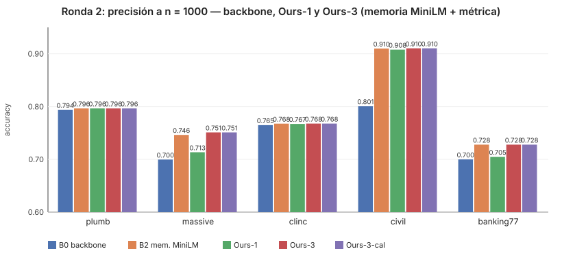
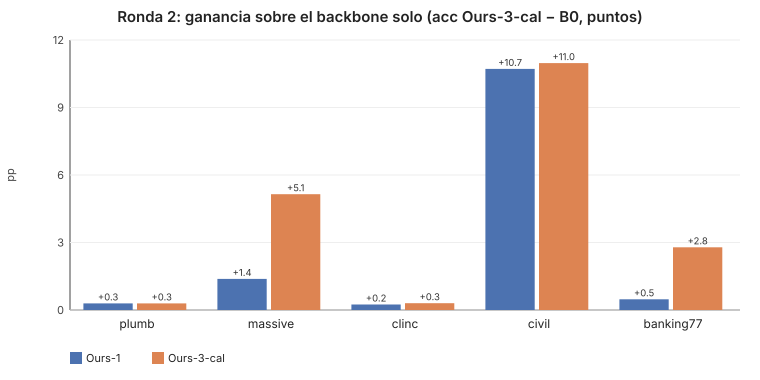
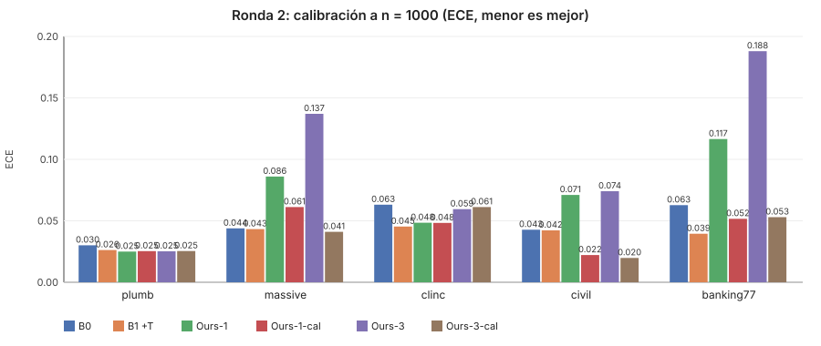

| Dataset | Backbone solo (B0) | Ours‑3‑cal | Ganancia | ECE B0 → Ours‑3‑cal |
|---|---|---|---|---|
| plumb | 0.794 | 0.796 | +0.2 pp | 0.030 → 0.025 |
| massive | 0.700 | 0.751 | **+5.1 pp** | 0.044 → 0.041 |
| clinc | 0.765 | 0.768 | +0.3 pp | 0.063 → 0.061 |
| civil | 0.801 | 0.910 | **+10.9 pp** | 0.043 → 0.020 |
| banking77 | 0.700 | 0.728 | **+2.8 pp** | 0.063 → 0.053 |

Ours‑3‑cal mejora o iguala al backbone en precisión **y** en calibración en los 5 dominios (en civil, recordar la lectura por pregunta: la
precisión sube sobre todo porque deja de alarmar en clases raras).

### ¿Mejora a medida que conoce al cliente?

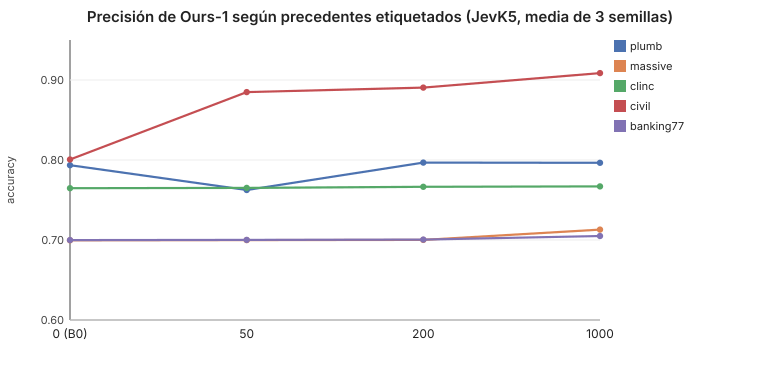

Con 50 precedentes la memoria puede empeorar (plumb −3 pp); desde ~200 no hace daño; las ganancias crecen despacio con n cuando el
backbone ya sabe la tarea (intents) y llegan rápido cuando lo que hay que aprender es la convención de etiquetado del cliente (civil).

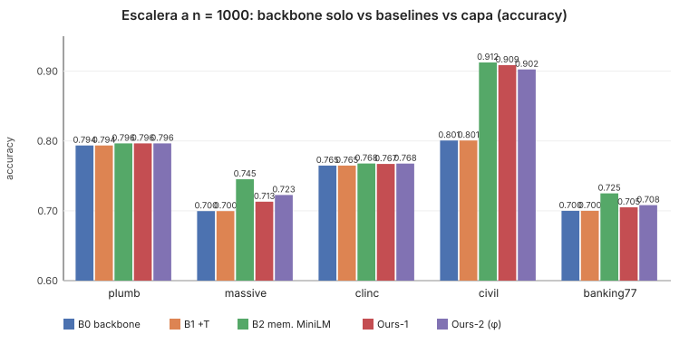
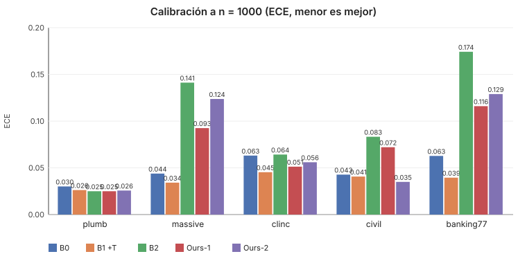

La memoria sobre embeddings MiniLM (B2) retrieve mejor que la memoria sobre el estado oculto del backbone en intents, y la fusión
empeora la calibración salvo Ours‑2 en civil: dos líneas abiertas (§6).

### La coherencia es la palanca más fuerte y es gratis

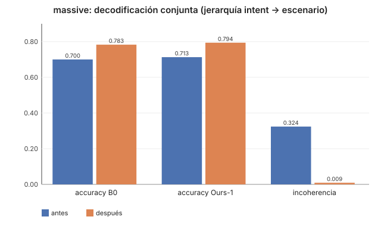

Declarar la jerarquía intent → escenario y decodificar en conjunto sube la precisión 8 pp con el backbone solo, por 0.1 ms de CPU.

### La precisión engaña en clases raras

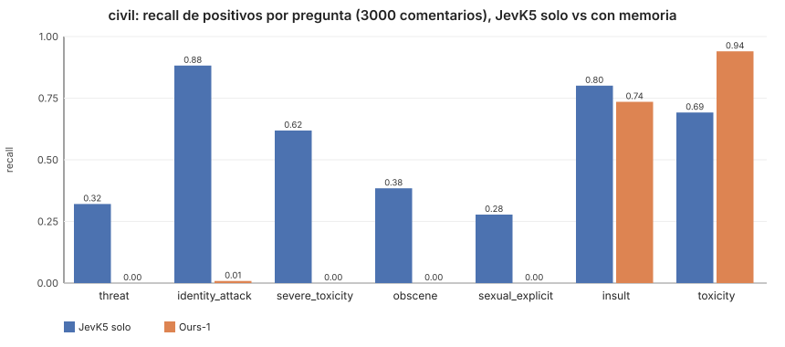
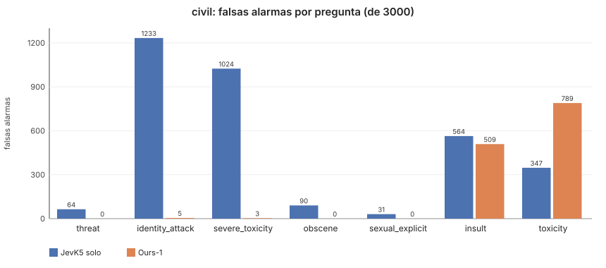

Civil pasa de 0.801 a 0.909 de precisión con memoria, pero con ~143 etiquetas por pregunta la memoria aprende la tasa base y deja de
detectar amenazas (17 → 0 de 53). Donde la clase es frecuente (toxicidad) el recall sube de 69 % a 94 %. La memoria debe ir acoplada
a la decisión por coste y reportarse con recall por pregunta.

### Cuanto más débil el backbone, más vale la memoria (G9)

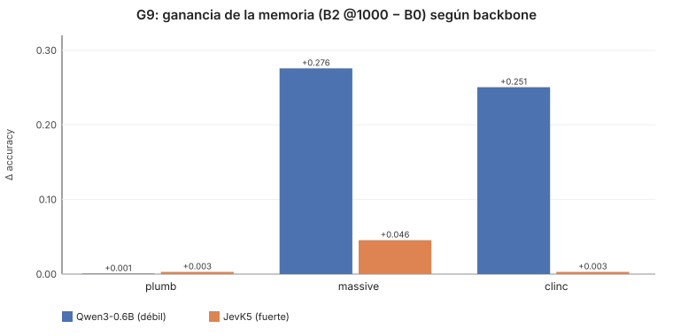

### Coste por decisión

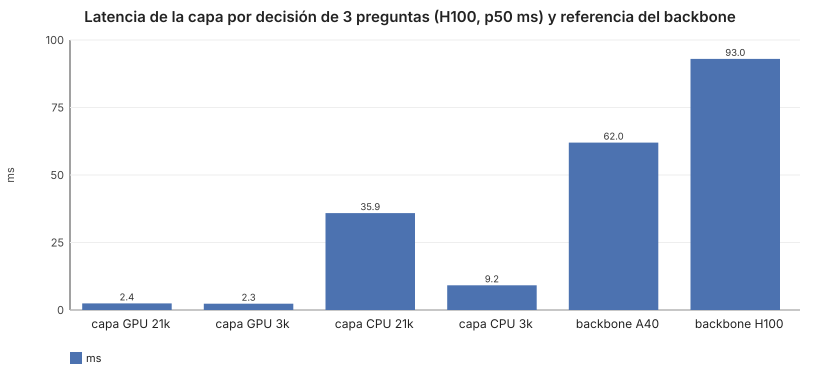

Tokens: los mismos que el backbone solo. Capa: 2.4 ms en GPU (H100, 21 k precedentes) sobre decisiones de 60–150 ms. Preparar un
cliente con 1000 precedentes: 2–3 min de A40 y 5 KB por precedente. En CPU, ver §5 h.

---

## 2. Datos

Todos los datasets se normalizan al mismo contrato (`dec.schema.DecisionItem`): un **estado** (texto o JSON), una **pregunta**
(`noul` sí/no, `choice`, `score` ordinal) con **opciones** `(key, desc)`, el **gold**, y una `question_key` que identifica la pregunta
dentro del dataset (la memoria de precedentes se particiona por ella).

| Dataset | Nivel | Split memoria / eval | Preguntas (`question_key`) | Notas |
|---|---|---|---|---|
| plumb | 1 | train 5014 / test 131 (+ 25 variantes `:noev` para G8) | ~36 familias (routing, judge, trap, ambiguous, adversarial…) | decisiones tipo JevBench; estados largos |
| MASSIVE (en‑US) | 1 | 3000 estados × 2 / 5948 | `massive:intent` (60), `massive:scenario` (18) | jerarquía intent → escenario para G3 |
| CLINC150 (plus) | 1 | 3000 / 5500 | `clinc:intent` (151 + fuera de alcance) | OOS para G4 |
| Civil Comments | 2 | 3000 estados × 7 / 3000 × 7 | `civil:{toxicity, severe_toxicity, obscene, threat, insult, identity_attack, sexual_explicit}` (sí/no) | umbral 0.3 en `severe_toxicity`; implicaciones minadas para G3 |
| Banking77 | 2 | 3000 / 3076 | `banking77:intent` (77) | |
| JevBench público | — | — / 231 (original 72, easy 48, hard 111) | `jevbench:<tier>:<tipo>` | comparación con cifras publicadas vía el harness real |

Ejemplos reales de JevBench (los tres tipos de pregunta; el estado puede ser texto o un objeto JSON):

```json
{"state": "Policy: refunds require a receipt and purchase within 30 days. A customer bought 12 days ago but has no receipt. Issue a refund.",
 "question": {"type": "noul", "instructions": "Under the stated policy, is the requested action permitted? Treat unproved required conditions as not satisfied.",
              "criteria": {"true": "Every required condition is established and no prohibition applies.", "false": "A condition is missing or a prohibition applies."}},
 "labels": ["no", "yes"], "expected": "no"}
```
```json
{"state": "Do not cancel my membership. Please return the duplicate charge.",
 "question": {"type": "choice", "instructions": "Select the primary requested action. A mention without a request does not establish intent.",
              "criteria": {"cancel": "End an existing subscription", "change_address": "Modify a delivery address", "other": "None of these actions is requested",
                           "refund": "Return money already charged", "status": "Learn delivery progress"}},
 "labels": ["cancel", "refund", "status", "change_address", "other"], "expected": "refund"}
```
```json
{"state": "The icon is misaligned. Every function works.",
 "question": {"type": "score", "instructions": "Rate incident impact using only reported facts. Use the highest fully supported level.",
              "criteria": ["No function impaired; cosmetic only", "One user or a nonessential function impaired, with a workaround",
                           "Many users blocked from a core function, no data loss", "Confirmed irreversible data loss or physical harm"]},
 "labels": ["0", "1", "2", "3"], "expected": 0}
```

Dos detalles que importan y costaron un día de depuración: **el orden de las opciones es el de `criteria`** (lo que el harness envía;
difiere de `labels` en 193 de 231 ítems y JevK5 cambia de respuesta en ~8 % de los ítems al invertirlo), y **los estados dict se
embeben como JSON nativo** en el prompt de JevK5 (fiel a su runtime) y como texto (`state_text`) en todo lo demás.

Los loaders viven en `src/dec/data/` y cachean en `cache/data/*.jsonl`; `dec-eval audit` comprueba contaminación memoria/evaluación
(8‑gramas y duplicados exactos; los duplicados se excluyen del pool).

---

## 3. Cómo funciona

```
estado + pregunta ──► prompt (jevk5 ≤ 16 opciones | numeric: letras ≤ 20, códigos de 2 letras ≤ ~500, sufijos)
                 ──► backbone, UNA pasada: p0 (logits de los códigos / T) + h (media del estado oculto sobre el estado)
h ──► memoria de precedentes (partición = question_key; candidatos por producto interno + rerank con métrica aprendida; τ calibrada)
      ──► p_mem, masa ──► fusión  p = fuse(p0, p_mem, masa; λ(masa), T)
varias preguntas del mismo estado ──► joint_decode(p por pregunta, restricciones) ──► MAP consistente
p, masa, estado ──► gap_signals ──► route (huecos | oráculo | consecuencia)
──► decide: acción Bayes (CostMatrix) o ESCALATE; umbral selectivo θ (SGR, riesgo ≤ α con confianza 1−δ); Decision con traza
```

- **Backbone** (`dec.backbone`): `Backbone(model_id, dtype="auto", style="jevk5"|"numeric", temperature, device="auto")` (cuda, mps o
  cpu; bf16 en CUDA, fp32 en el resto). `encode(items, token_budget)`
  devuelve `Encoded(p0, logits, h, h_last, readout)`. Hook en `model.norm` para el estado oculto; lotes por presupuesto de tokens para
  atención estándar; **batch‑1 para Qwen3.5** (sus kernels de atención lineal son más lentos por lotes). Caches parquet por
  `dataset_split__backbone_id`.
- **Memoria** (`dec.memory.PrecedentMemory`): FAISS en CPU o réplica exacta en GPU (`device="cuda"`); `calibrate_tau` fija τ por memoria
  para que la masa sea comparable entre consultas (sin eso, la masa es ~constante).
- **Métrica** (`dec.phi`): `GlobalDiagonalMetric` (diagonal global, NCA) o `PhiMask` (máscara por pregunta a partir del embedding
  MiniLM de la instrucción).
- **Fusión** (`dec.fusion`): `fit_fusion` por número de opciones (`FusionBank`), λ(masa) con umbrales débil/fuerte, `reason_code`.
- **Coherencia** (`dec.coherence`): `hierarchy(child_q, parent_q, parent_of)`, `implies(if_q, if_val, then_q, then_vals)`,
  `joint_decode(probs_by_q, constraints) -> (ajustadas, info)` con MAP consistente por backtracking.
- **Router y política** (`dec.router`, `dec.policy`): `gap_signals`, `fit_thresholds`, `route`; `bayes_action`, `decide(...)` con modos
  `benchmark` (nunca escala), `memory`, `escalation`.
- **Riesgo** (`dec.risk`): `sgr_threshold(conf, correct, r_star, delta)` sobre una rejilla fija de coberturas (Bonferroni);
  `conformal_quantile` para conjuntos.
- **Evaluación** (`dec.eval`): escalera B0 (backbone), B1 (+T), B2 (memoria MiniLM), B3 (memoria h), Ours‑1 (+métrica global),
  Ours‑2 (+φ); `prepare` / `run_config` / `curves`; gates en `scripts/gates/`.
- **Pool del cliente** (`dec.pool`, `dec-pool`): historial JSONL → directorio con decisiones, codificaciones, embeddings MiniLM y
  `pool.json`; `MemoryPool.from_dir` ajusta memoria, métrica, fusión, τ y umbral al cargarlo.
- **Servidor** (`dec.serve`): `/v1/systemone` compatible con el adaptador `typesafe` del harness de JevBench, `/health`; modo
  `benchmark` (backbone solo) o `memory` (`--pool-dir`).

---

## 4. Requisitos

### Hardware y software

| Recurso | Mínimo | Lo usado en la exploración | Notas |
|---|---|---|---|
| GPU | recomendada: CUDA, 16 GB de VRAM (sin GPU corre en CPU, §5 h) | A40 48 GB, H100 80 GB, A6000 48 GB | JevK5 bf16 en batch‑1: pico **9 GB** de VRAM; lectura por sufijos (opcional): 12.5 GB |
| Driver NVIDIA | CUDA 12.x | 12.8 y 13.0 | torch de PyPI (cu130) exige driver ≥ 580; con driver 12.x instalar `torch` desde `https://download.pytorch.org/whl/cu124` |
| Python | 3.11 | 3.11 | `requires-python = ">=3.11,<3.12"` |
| RAM | 16 GB servir con GPU · 32 GB servir JevK5 en CPU o evaluar | 503 GB (servidor de evaluación) | curvas y gates: < 8 GB por proceso; G6 (NCA con 12 k precedentes) ≈ 8 GB de pico |
| Disco | 30 GB | 60 GB | modelos: JevK5 8.4 GB, Qwen3.5‑4B 9.3 GB, Qwen3‑0.6B 1.5 GB; venv con torch ≈ 8 GB; caches de codificaciones ≈ 10 KB por ítem (≈ 0.8 GB para los 74 k ítems de la exploración, estimado) |
| CPU | 4 núcleos (8 para servir JevK5 en CPU) | 96–208 vCPU | la capa en CPU con búsqueda exacta: 9 ms (3 k precedentes) a 36 ms (21 k); en GPU 2.4 ms. JevK5 entero en CPU: ~1.7 s por decisión con 8 hilos (§5 h) |

Dependencias Python: las de `pyproject.toml` (torch ≥ 2.6, transformers ≥ 5.19, faiss‑cpu, sentence‑transformers, fastapi, …).
Opcional para JevK5/Qwen3.5: `pip install "flash-linear-attention>=0.5"` (≈ 1.5× más rápido; sin él usa kernels de referencia).
`causal-conv1d` no es necesario (y no compila con nvcc 12.4 + torch cu130).

### Qué necesita la memoria de un cliente

| Requisito | Para qué | Mínimo recomendado |
|---|---|---|
| **Decisiones pasadas etiquetadas** (estado, pregunta, opciones, decisión correcta) | precedentes, ajuste de métrica, fusión y umbral de riesgo (todo dejando‑uno‑fuera) | **≥ 200 por pregunta**: con 50 la memoria puede empeorar (plumb −3 pp); con 1000 las ganancias se estabilizan |
| **`question_key` estable por pregunta** | la memoria se particiona por pregunta; en el servidor el cliente la declara en `questions.decision.question_key` | una clave por pregunta "lógica" (p. ej. `soporte:prioridad`), no por redacción |
| **Positivos suficientes por clase** | con clases raras (< 5 %) la memoria aprende la tasa base y deja de detectarlas | ≥ 50 positivos por clase rara, o decidir por coste sin memoria en esa pregunta |
| Restricciones entre preguntas (opcional) | decodificación conjunta (`hierarchy`, `implies`) | declararlas explícitamente |
| Matriz de costes y α (opcional) | acción Bayes con `ESCALATE` y umbral selectivo con garantía | ≥ 1000 decisiones para un umbral con confianza 95 % a α = 0.05 |
| Almacenamiento | 5 KB por precedente (fp16, d = 2560) | 1000 precedentes ≈ 5 MB; búsqueda en GPU a partir de unos miles |
| Tiempo de preparación | codificar los precedentes: una pasada del backbone por precedente | 1000 precedentes ≈ 2–3 min en A40, ≈ 30 min en CPU (8 hilos) |

Configuración recomendada tras la ronda 2: **Ours‑3‑cal** (memoria sobre MiniLM + métrica global + temperatura post‑fusión).

## 5. Puesta en producción en tu máquina

Todo corre en local: el historial, el pool y las peticiones no salen de la máquina. Lo único que se descarga de internet son los pesos
de los modelos desde Hugging Face (JevK5 u otro backbone, y MiniLM para la memoria) la primera vez.

### a) Requisitos

Python 3.11; GPU NVIDIA recomendada (JevK5 en bf16 pide ~9 GB de VRAM), pero también corre en CPU (fp32, ~24 GB de RAM, segundos por
decisión) o en Mac con `--device mps`. Detalle en la [§4](#4-requisitos).

### b) Instalación

```bash
git clone <url-del-repo> ours && cd ours
python3.11 -m venv .venv && source .venv/bin/activate

# con GPU NVIDIA (driver con CUDA 12.x: torch desde el índice cu124; con driver ≥ 580 alcanza con el torch de PyPI)
pip install "torch>=2.6" --index-url https://download.pytorch.org/whl/cu124
pip install -e ".[fast]"          # fast = flash-linear-attention: ~1.5× en JevK5/Qwen3.5 (opcional)

# solo CPU (sin CUDA: torch de CPU, ~200 MB en vez de ~2.5 GB)
pip install "torch>=2.6" --index-url https://download.pytorch.org/whl/cpu
pip install -e .

pip install -e ".[dev]" && pytest -q     # opcional: los tests de GPU se saltan si no hay CUDA
```

`--device auto` (el default de todas las herramientas) elige CUDA si hay, si no MPS, si no CPU; `--dtype auto` usa bf16 en CUDA y fp32
en el resto.

### c) Armar el pool con tu historial

El pool son tus decisiones pasadas, ya resueltas. Un archivo JSONL con **una decisión por línea**, con la misma forma de pregunta que
acepta el servidor más la decisión correcta:

```json
{"id": "t-005:priority",
 "state": "Since this morning nobody in the sales team can create new quotes; the button returns error 500.",
 "question": {"type": "choice", "instructions": "Assign the support priority of this ticket using only the facts reported.",
              "criteria": {"low": "Question or cosmetic issue, no impact on work", "medium": "One user affected, a workaround exists",
                           "high": "A core feature is broken for several users, no workaround",
                           "urgent": "Outage, data loss or security incident affecting the business"},
              "question_key": "support:priority"},
 "decision": "high"}
```

| Campo | Qué va |
|---|---|
| `state` | texto, o un objeto/lista JSON |
| `question.type` | `noul` (sí/no), `choice` (opciones) o `score` (niveles ordenados) |
| `question.criteria` | `noul`: `{"true": ..., "false": ...}`; `choice`: `{opción: descripción}` (el orden importa); `score`: lista de niveles |
| `question.question_key` | **obligatoria**: identifica la pregunta lógica (`support:priority`); la memoria se separa por ella |
| `decision` | `noul`: `"yes"`/`"no"` (o `true`/`false`); `choice`: la clave de la opción; `score`: el índice del nivel (0, 1, …) |
| `id` | opcional; único. Si falta se deriva del contenido |

[`examples/history_example.jsonl`](examples/history_example.jsonl) trae 18 filas sintéticas de tickets de soporte con dos preguntas
(`support:priority`, `choice`, y `support:escalate`, `noul`). Para construir el pool:

```bash
dec-pool build --history examples/history_example.jsonl --backbone alibiserikbay/JevK5 --style jevk5 --T 1.22 --out pool/
dec-pool info pool/
```

`build` valida todo el archivo antes de cargar el modelo (los errores salen con su número de línea), codifica cada decisión con el
backbone (una pasada por fila) y escribe en `pool/`:

| Archivo | Contenido |
|---|---|
| `items.jsonl` | las decisiones normalizadas (`DecisionItem`) |
| `enc.parquet` | lo que el backbone leyó de cada una (`p0`, logits, estado oculto) |
| `minilm.npy` | embedding MiniLM de cada estado (la memoria de **Ours‑3‑cal**, la configuración recomendada) |
| `pool.json` | backbone, estilo, T, dtype, features, configuración, conteos por `question_key` y clase, fecha, versión de `dec` |

`info` muestra los conteos y avisa por `question_key` cuando hay **menos de 200 precedentes** o alguna clase con **menos de 50**
ejemplos (§4: con pocos precedentes la memoria puede empeorar al backbone solo). El ejemplo de 18 filas dispara los dos avisos a
propósito: sirve para probar el circuito, no para decidir. `--features h` usa el estado oculto del backbone en vez de MiniLM (Ours‑1‑cal).

**Actualizar el pool**: agregá las decisiones nuevas al historial y volvé a correr el mismo `dec-pool build` sobre el mismo `--out`. Es
reanudable: solo codifica los `id` que no estaban (y descarta los que ya no figuran); si se corta a mitad, retoma desde el último
checkpoint. Después reiniciá el servidor: el ajuste se hace al arrancar. Para cambiar de backbone, estilo o T usá otro `--out`.

### d) Servir

```bash
dec-serve --pool-dir pool/                       # modo memory; backbone, estilo y T salen de pool/pool.json
dec-serve --pool-dir pool/ --device cpu --port 8090 --host 127.0.0.1
```

Al arrancar carga el backbone y ajusta sobre el pool la memoria, la métrica, la fusión con temperatura post‑fusión, τ y el umbral de
riesgo (segundos; 0.1–0.6 s con el ejemplo). Las peticiones declaran su `question_key`; si no está en el pool, la pregunta se responde con
el backbone solo y se cuenta en `usage.unmapped`.

```bash
curl -s http://127.0.0.1:8090/v1/systemone -H 'Content-Type: application/json' -d '{
  "model": "dec",
  "state": "Checkout is failing with error 500 for every customer since the deploy an hour ago.",
  "questions": {"decision": {"type": "choice", "question_key": "support:priority",
    "instructions": "Assign the support priority of this ticket using only the facts reported.",
    "criteria": {"low": "Question or cosmetic issue, no impact on work", "medium": "One user affected, a workaround exists",
                 "high": "A core feature is broken for several users, no workaround",
                 "urgent": "Outage, data loss or security incident affecting the business"}}}}'
```

```json
{"model": "dec", "usage": {"items": 1, "memory_hits": 1, "unmapped": 0},
 "answers": {"decision": {"type": "choice", "choice": "urgent",
                          "probabilities": {"low": 0.01, "medium": 0.02, "high": 0.31, "urgent": 0.66}}}}
```

(Probabilidades ilustrativas.) `noul` responde `{"type": "noul", "noul": P(sí)}` y `score` responde `probabilities` por índice de
nivel. `GET /health` informa el backbone, el device, el pool (`pool_dir`, `config`, `features`, `pool_size`, `question_keys`, θ) y los
contadores acumulados (`requests`, `memory_hits`, `unmapped`). El servidor escucha en `127.0.0.1` por defecto; `--host 0.0.0.0` lo
expone en la red (no trae autenticación: ponelo detrás de tu proxy).

### e) Docker

```bash
dec-pool build --history mi_historial.jsonl --backbone alibiserikbay/JevK5 --style jevk5 --T 1.22 --out pool/   # o dentro del contenedor:
docker compose --profile cpu run --rm --entrypoint dec-pool dec-cpu build --history /pool/historial.jsonl \
  --backbone alibiserikbay/JevK5 --style jevk5 --T 1.22 --out /pool --device cpu

docker compose --profile gpu up -d     # GPU: necesita NVIDIA Container Toolkit
docker compose --profile cpu up -d     # CPU: DEC_THREADS=8 por defecto (hilos de torch)
```

`Dockerfile` (CUDA 12.4 + cuDNN runtime, Python 3.11, `.[fast]`) y `Dockerfile.cpu` (`python:3.11-slim` con torch de CPU) corren como
usuario sin privilegios (uid 1000), exponen el 8090 y arrancan `dec-serve --host 0.0.0.0 --pool-dir /pool`. Compose monta `./pool` en
`/pool` y la caché de Hugging Face en `/models` (`HF_CACHE`, por defecto `./hf-cache`; tiene que ser escribible por el uid 1000) y
publica el puerto solo en `127.0.0.1`. Los Dockerfiles se validaron con `hadolint`, pero las imágenes todavía no se construyeron ni
probaron en este repositorio.

### f) Modo benchmark (comparar con JevBench)

Sin pool, `dec-serve` sirve el backbone solo con el contrato del adaptador `typesafe` de JevBench (es lo que se midió en G0/G6):

```bash
dec-serve --backbone alibiserikbay/JevK5 --style jevk5 --T 1.22 --port 8091 --mode benchmark
# desde el harness de JevBench (clonado en vendor/jevbench: scripts/fetch_jevbench.sh):
python -m jevbench.cli run --tasks datasets/public/hard.jsonl --adapter typesafe --endpoint http://127.0.0.1:8091 \
  --key-env TYPESAFE_API_KEY --model dec --price-in-per-m 0 --price-out-per-m 0 --results RUN/results.jsonl --raw-dir RUN/raw \
  --ledger RUN/ledger.jsonl --cap-usd 1 --manifest RUN/manifest.json
```

`--memory-pool dataset:split` (p. ej. `plumb:train`) sigue disponible para servir con un pool de los datasets de investigación.

### g) API de Python (coherencia, costes y riesgo)

El servidor cubre el caso de una pregunta por petición. Para varias preguntas sobre el mismo estado con restricciones, costes propios y
`ESCALATE`, la misma lógica está en la API:

```python
from dec.backbone.model import Backbone
from dec.serve.memory_pool import MemoryPool
from dec.serve.wire import parse_request
from dec.schema import CostMatrix
from dec.coherence import implies, joint_decode
from dec.router import RouterThresholds, gap_signals, route
from dec.policy import decide

bb = Backbone("alibiserikbay/JevK5", style="jevk5", temperature=1.22)        # device y dtype "auto"
pool = MemoryPool.from_dir("pool/", bb=bb)          # memoria + métrica + fusión (T post) + τ + umbral de riesgo, en segundos

# una decisión nueva: varias preguntas (con la question_key del pool) sobre el mismo estado
_, items = parse_request({"state": ticket_text, "questions": {"priority": priority_q, "escalate": escalate_q}})
E = bb.encode(items)
res = {it.id: pool.predict(it, e) for it, e in zip(items, E)}            # (fused, hit, riesgo, reason, question_key)

# estructura y costes declarados: "urgente" implica escalar; perder un urgente cuesta 20, escalar cuesta 1
constraints = [implies("support:priority", "urgent", "support:escalate", {"yes"})]
costs = CostMatrix(loss={("low", "urgent"): 20.0, ("medium", "urgent"): 20.0}, c_escalate=1.0)
_, info = joint_decode({it.question_key: dict(zip(it.option_keys(), map(float, res[it.id][0]))) for it in items}, constraints)
for it, e in zip(items, E):
    fused, hit, risk, reason, _ = res[it.id]
    v = route(gap_signals(it, fused, hit.mass), costs, RouterThresholds(mass=1.0), bool(constraints))
    d = decide(it, e.p0, hit, fused, v, risk, costs, "escalation", None, info, reason)
    print(it.question_key, d.action, d.probs, d.reason_code)     # acción (o ESCALATE), probabilidades, razón, precedentes, riesgo
```

Las piezas sueltas (`PrecedentMemory`, `GlobalDiagonalMetric`/`fit_nca`, `fit_fusion_grouped`, `sgr_threshold`, `fit_thresholds`) están
descritas en la §3 por si hace falta armar el ajuste a mano.

Reglas de oro aprendidas: usar **recall por pregunta** además de precisión cuando hay clases raras; con **menos de ~200 precedentes**
servir el backbone solo (modo benchmark); en **modo benchmark sin pool compatible, servir el backbone solo** (G6); la búsqueda en
**GPU** si la memoria pasa de unos miles de precedentes (G7).

### h) Notas de operación

**Latencia medida** (una decisión de punta a punta en el proceso: backbone + MiniLM + memoria + fusión; mediana de 8–10 decisiones del
historial de ejemplo, tras calentar; `python scripts/bench_local.py` repite la medición en tu máquina):

| Backbone | Hardware | dtype | Mediana | p90 | Memoria pico |
|---|---|---|---|---|---|
| Qwen3‑0.6B | CPU, 8 hilos | fp32 | 0.23 s | 0.25 s | 5 GB de RAM |
| JevK5 (4B) | CPU, 8 hilos | fp32 | 1.7 s | 1.9 s | 24 GB de RAM |
| Qwen3‑0.6B | GPU A40 | bf16 | 0.03 s | 0.03 s | — |
| JevK5 (4B) | GPU A40 | bf16 | 0.06 s | 0.06 s | 8.2 GB de VRAM |

CPU: contenedor con una cuota de ~7.6 vCPU de un Xeon Gold 6342 (2.8 GHz) compartido; en una máquina dedicada de 8 núcleos debería
andar parecido, y con más núcleos libres algo mejor. Por HTTP (`dec-serve --pool-dir`, que calienta el modelo al
arrancar), Qwen3‑0.6B midió 0.34–0.41 s por petición en esa CPU y 0.03–0.08 s en la A40. **Hilos**: con cuota de CPU, más hilos que vCPU reales multiplican la latencia (JevK5:
1.7 s con 8 hilos, 4.5 s con 24); `dec-serve` y `dec-pool` detectan la cuota del cgroup (Docker `--cpus`, Kubernetes) y si no la hay usan
el default de torch; `--threads N` lo fija a mano. Construir el pool en CPU: unos 2 s por decisión con JevK5 (≈ 30 min por 1000).

**Memoria**: JevK5 pide ~9 GB de VRAM en bf16 (12.5 GB con la lectura por sufijos) o ~24 GB de RAM en fp32 en CPU; Qwen3‑0.6B, ~5 GB de
RAM en CPU. El pool ocupa ~5 KB por precedente en `enc.parquet` más 1.5 KB en `minilm.npy`.

**Privacidad**: el historial, el pool y las peticiones no salen de tu máquina; la única conexión saliente es la descarga de modelos de
Hugging Face (una vez; después alcanza con `HF_HUB_OFFLINE=1`).

### Reproducir la exploración

Con GPU y los scripts públicos del repositorio (los datasets se descargan de Hugging Face; JevBench se clona con
`scripts/fetch_jevbench.sh`):

```bash
BB=alibiserikbay/JevK5@main:jevk5:bf16                      # backbone_id = modelo@revisión:estilo:dtype
python scripts/cache_dataset.py --dataset massive --split train --backbone alibiserikbay/JevK5 --style jevk5 --T 1.22 --dtype bf16 --token-budget 1
python scripts/cache_dataset.py --dataset massive --split test  --backbone alibiserikbay/JevK5 --style jevk5 --T 1.22 --dtype bf16 --token-budget 1
dec-eval audit --dataset massive                               # contaminación memoria/evaluación
dec-eval curves --dataset massive --backbone $BB --configs B0 B1 B2 B3 ours1 ours2 ours1cal ours3 ours3cal
python scripts/gates/g3_coherence.py                           # cada gate (g0..g9, r2*) aplica su regla pre-registrada sobre las caches
python scripts/gates/g7_latency.py && python scripts/gates/g9_weak.py --weak-dir results_qwen06
python scripts/make_readme_charts.py                           # regenera docs/img/*.svg
```

---

## 6. Estructura del repositorio

```
src/dec/            schema, backbone/ (prompt, readout, model, cache), data/ (loaders + contaminación), memory, phi, fusion, pool,
                    coherence, router, policy, risk, metrics, eval/ (ladder, curves, cli, unanswerable), serve/
scripts/gates/      g0..g9, rules.py (reglas puras), common.py, _util.py, replay_ledger.py
scripts/            cache_dataset.py, bench_layer.py, bench_local.py (latencia en tu máquina), make_readme_charts.py
examples/           history_example.jsonl (historial de ejemplo para dec-pool)
Dockerfile*         imágenes GPU (CUDA 12.4) y CPU; docker-compose.yml con perfiles gpu y cpu
docs/gates/         exploracion.md (libro de hipótesis e intentos), results/ (JSON de gates y curvas, informe)
tests/              125+ tests (pytest; los de GPU se saltan sin CUDA)
vendor/             graph/ (herramienta del libro de exploración, MIT, del propio autor);
                    vendor/jevbench se clona con scripts/fetch_jevbench.sh (MIT) y no se versiona
```

## 7. Limitaciones y siguientes intentos

1. Recalibración post‑fusión (la memoria sube el ECE). 2. Memoria sobre MiniLM + métrica (B2 gana a h en intents). 3. Decisión por coste
con prior corregido por frecuencia (clases raras). 4. Detector de huecos semántico (el léxico es débil). 5. Regla G8 estricta y G4 con
α = 0.10 informativo. 6. Modo memoria en `dec-serve` con mapeo declarado de `question_key` para pools externos.

Las reglas de esta ronda no se cambian retroactivamente; cada nuevo intento se pre‑registra en `docs/gates/exploracion.md`.
